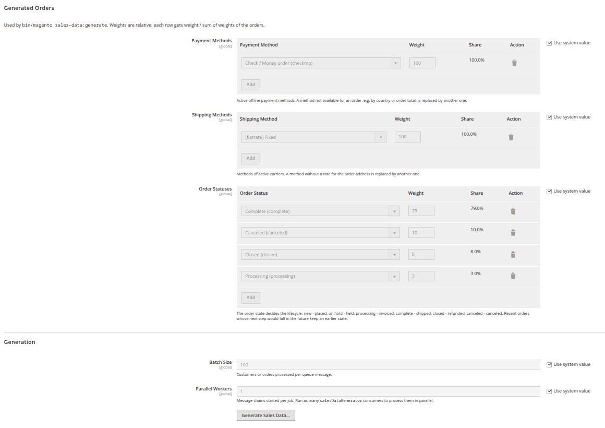
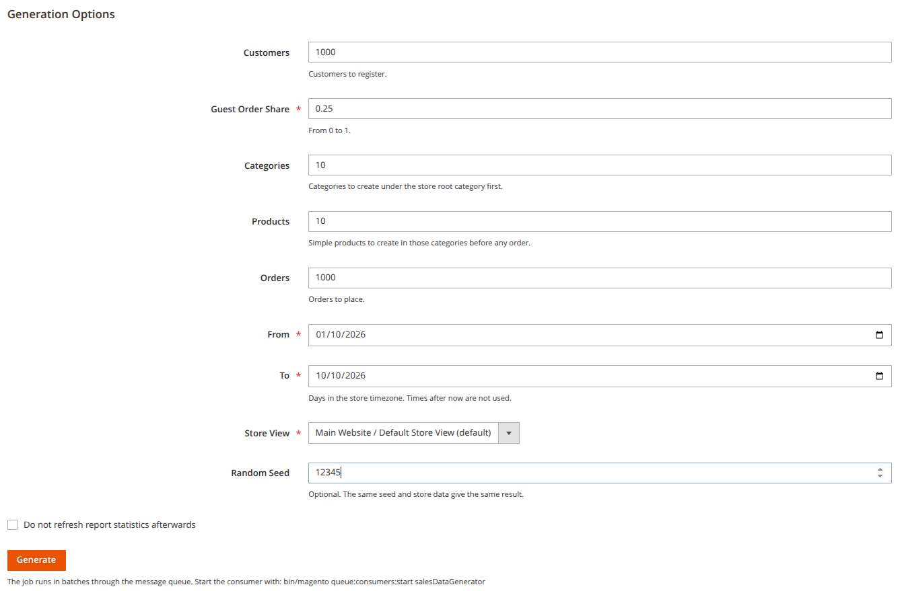
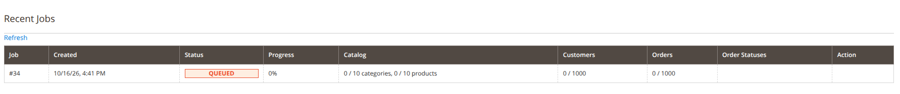
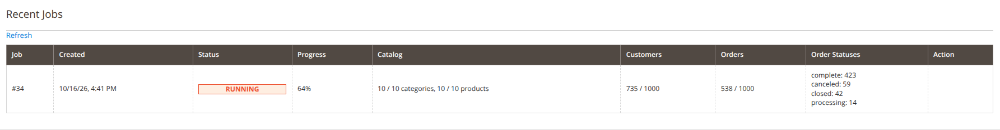
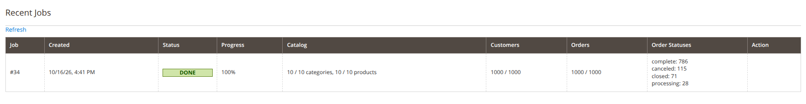

# Perspective_SalesDataGenerator

**Українська** · [English](README.en.md)

Інструмент розробника для Magento 2. Наповнює магазин тестовими клієнтами та замовленнями,
розподіленими в минулому за заданий період. Корисний для розробки й перевірки звітів,
дашбордів та аналітики, яким потрібна правдоподібна історія продажів.

> Модуль призначений лише для середовищ розробки й тестування. У production-режимі генерація заблокована.

## Можливості

- **Реалістичний таймлайн.** Замовлення розподіляються з урахуванням днів тижня (вихідні тихіші),
  сезонів (тиждень Black Friday, грудень, спад у січні та влітку), поступового зростання магазину,
  денного шуму та добової кривої трафіку в часовому поясі магазину.
- **Справжній checkout.** Замовлення створюються через quote, тож суми, податки, доставка, оплата
  та резервування залишків рахуються так само, як у звичайному замовленні.
- **Життєвий цикл замовлення.** Рахунок, відвантаження, скасування, утримання та повернення з
  правдоподібними затримками між кроками. Усі дати переносяться в минуле разом із документами та гридами.
- **Клієнти й гості.** Клієнти реєструються до своїх замовлень. Кілька лояльних клієнтів купують
  значно частіше за решту. Частка гостьових замовлень налаштовується.
- **Каталог.** За потреби генератор спершу створює дерево категорій і прості товари з цінами
  та залишками, тож працює й на порожньому магазині.
- **Популярність товарів.** Розподіл із «довгим хвостом» дає звітам чіткі бестселери.
  Підтримуються прості та конфігуровані товари.
- **Зважені налаштування.** Методи оплати, методи доставки та статуси замовлень обираються
  за вагами, заданими в адмінці.
- **Мільйони сутностей.** Зберігається лише кількість клієнтів і замовлень на кожен день; точні моменти
  та покупці відтворюються з seed під час обробки, тож розмір плану не залежить від кількості замовлень.
- **Паралельна обробка через чергу.** Кілька консюмерів RabbitMQ обробляють різні дні одного job'а.
  Перерваний job продовжується без дублікатів.
- **Відтворюваність.** Із seed той самий набір параметрів дає ті самі дані.

## Вимоги

- Magento Open Source / Adobe Commerce 2.4.7 або новіша
- PHP 8.3+
- RabbitMQ, налаштований як з'єднання `amqp` в `app/etc/env.php`
- Товари, які можна купити (наприклад, Luma sample data), або генерація каталогу самим job'ом
- Принаймні один активний офлайн-метод оплати (наприклад, Check / Money order)
  та один активний перевізник (наприклад, Flat Rate)
- <a id="env-multiple-processes"></a>Для паралельної обробки через cron — кількість процесів консюмера
  в `app/etc/env.php` (за замовчуванням cron запускає лише один `salesDataGenerator`); вона має
  дорівнювати **Parallel Workers**:

  ```php
  'cron_consumers_runner' => [
      'cron_run' => true,
      'multiple_processes' => [
          'salesDataGenerator' => 4,
      ],
  ],
  ```

  Якщо в `cron_consumers_runner/consumers` задано список консюмерів, `salesDataGenerator` має бути в ньому.
- `memory_limit` для CLI без обмеження (`-1`) або щонайменше `512M` за налаштувань за замовчуванням.
  Точніше значення залежить від кількості консюмерів, Batch Size і розміру каталогу, див.
  [Пам'ять, швидкість і кількість консюмерів](#память-швидкість-і-кількість-консюмерів).

## Встановлення

### Через Composer

```bash
composer config repositories.sales-data-generator vcs https://github.com/sydor-labs/module-sales-data-generator
composer require --dev perspectiveteam/module-sales-data-generator:^1.0
bin/magento module:enable Perspective_SalesDataGenerator
bin/magento setup:upgrade
```

### Вручну

Скопіюйте вміст репозиторію в `app/code/Perspective/SalesDataGenerator`, а потім виконайте:

```bash
bin/magento module:enable Perspective_SalesDataGenerator
bin/magento setup:upgrade
```

## Налаштування

**Stores → Configuration → Perspective Studio → Sales Data Generator**



### Generated Orders

Три таблиці «варіант + вага». Ваги відносні: частка рядка дорівнює його вазі, поділеній на суму
всіх ваг. Наприклад, ваги 80 і 20 дають ті самі 80% / 20%, що й 4 і 1. Колонка **Share** показує
підсумкову частку під час редагування.

| Поле | Варіанти | За замовчуванням |
|---|---|---|
| Payment Methods | Активні офлайн-методи оплати | `checkmo` 100 |
| Shipping Methods | Методи активних перевізників | `flatrate_flatrate` 100 |
| Order Statuses | Статуси станів new, holded, processing, complete, closed, canceled, включно з власними | complete 79, canceled 10, closed 8, processing 3 |

Під час збереження перевіряється, що немає дублікатів, усі варіанти доступні, ваги не від'ємні,
а хоча б одна вага більша за нуль.

Як використовуються налаштування:
- Якщо обраний метод доставки не має тарифу для адреси замовлення, генератор бере інший із налаштованих.
  Так само з методом оплати, недоступним для замовлення (через країну, валюту чи суму).
- Стан статусу визначає, що відбувається із замовленням:

  | Стан | Дії |
    |---|---|
  | new | лише розміщення |
  | holded | розміщення та утримання |
  | processing | рахунок |
  | complete | рахунок і відвантаження |
  | closed | рахунок, відвантаження та повне повернення |
  | canceled | скасування |

  Власний статус встановлюється після досягнення його стану. Нещодавні замовлення, наступний крок
  яких припав би на майбутнє, залишаються в попередньому стані.

### Generation

| Поле | Опис | За замовчуванням |
|---|---|---|
| Batch Size | Скільки клієнтів або замовлень обробляє одне повідомлення черги | 100 |
| Parallel Workers | Скільки ланцюжків повідомлень запускається на job; для паралельної обробки потрібно стільки ж консюмерів | 1 |
| Catalog Segment Size | Скільки категорій або товарів містить один сегмент нового job'а; різні сегменти воркери створюють паралельно | 500 |
| Generate Sales Data... | Відкриває сторінку запуску генерації | — |

## Використання

### Адмінка

**Stores → Configuration → Perspective Studio → Sales Data Generator → Generate Sales Data...**



Форма містить ті самі параметри, що й CLI. Під формою є таблиця останніх job'ів: статус, прогрес,
розподіл замовлень за статусами, помилки та кнопка **Resume**. Натискання **Generate** створює job
і ставить його в чергу, тож для виконання потрібен запущений консюмер:

```bash
bin/magento queue:consumers:start salesDataGenerator
```

Для паралельної обробки має працювати стільки консюмерів, скільки задано в **Parallel Workers**.
Кожен консюмер бере по одному повідомленню, тож вони не забирають роботу один в одного. Модуль
сам консюмери не запускає, це можна зробити двома способами:

- **Вручну** (у кількох терміналах, через supervisor тощо) — по одному процесу на воркер:

  ```bash
  bin/magento queue:consumers:start salesDataGenerator --multi-process=1
  bin/magento queue:consumers:start salesDataGenerator --multi-process=2
  ```

- **Через cron.** За замовчуванням cron запускає лише один консюмер `salesDataGenerator`, тому
  кількість процесів потрібно задати в `app/etc/env.php`, як описано у [вимогах](#env-multiple-processes).

Консюмер завершується після 60 секунд без повідомлень (`maxIdleTime` в `etc/queue_consumer.xml`),
а якщо в `app/etc/env.php` задано `consumers_wait_for_messages = 0`, то одразу. Поки в черзі є
повідомлення, cron щохвилини запускає замість нього новий, тож одночасно працює стільки консюмерів,
скільки менше з двох значень: **Parallel Workers** або `multiple_processes`.

#### Пам'ять, швидкість і кількість консюмерів

Заміри з Batch Size 100 на магазині зі 100 000 товарів:

| Сутність | PHP-пам'ять | Пам'ять процесу (RSS) |
|---|---|---|
| Категорії | ~105 МБ | ~150 МБ |
| Товари | ~125 МБ | ~170 МБ |
| Клієнти | ~106 МБ | ~160 МБ |
| Замовлення | ~196 МБ, пік ~211 МБ | ~265 МБ |

- На кожні 1000 товарів каталогу споживання воркера росте на ~0.4 МБ
- На кожні додаткові 100 у Batch Size споживання воркера росте на ~5 МБ
- На кожен створений воркером товар додається ~0.2-0.3 КБ (~25 МБ на 100 000 товарів)

Приклад: 10 консюмерів, що створюють замовлення в такому магазині, потребують приблизно
10 × 265 МБ ≈ 2.7 ГБ, плюс пам'ять, яку під таким навантаженням додатково займуть MySQL і OpenSearch.

Останній контрольний запуск: 5 консюмерів, Batch Size 500, Catalog Segment Size 500,
2000 категорій, 20 000 товарів, 20 000 клієнтів і 20 000 замовлень за рік. Від створення job'а до
статусу **done** минуло ~18.5 хв, з них ~1 хв cron запускав консюмери.

Орієнтовний час на 1000 сутностей при 5 консюмерах:

| Сутність | Час на 1000 | Один воркер на одну сутність |
|---|---|---|
| Категорії | ~10–20 с | ~50–100 мс |
| Товари | ~7 с | ~35 мс |
| Клієнти | ~15 с | ~70–80 мс |
| Замовлення | ~25 с | ~120–130 мс |


Реальні цифри запуску — у `var/log/sales_data_generator.log` (див. нижче) і в
`ps -eo pid,rss,args | grep "[q]ueue:consumers:start salesDataGenerator"`.

#### Статуси job'а

Таблиця **Recent Jobs** не оновлюється сама: щоб побачити поточний стан, натисніть **Refresh**.

Одразу після створення job має статус **queued** і чекає, поки консюмер візьме перше повідомлення:



Під час обробки статус **running**. Колонки **Catalog**, **Customers** і **Orders** показують,
скільки сутностей уже створено, а **Order Statuses** — розподіл уже розміщених замовлень.
Каталог створюється першим, тому на цьому етапі він зазвичай уже завершений:



Коли всі сегменти оброблено, job ненадовго переходить у **finishing** (оновлення статистики
core-звітів), а потім у **done**:



Замовлення, які не вдалося розмістити, рахуються в **Orders** як оброблені й показуються під ним
окремим рядком «N failed». Якщо job завис (**stalled**) або впав (**failed**), у колонці **Action**
з'являється кнопка **Resume** (див. [Відновлення після збою](#відновлення-після-збою)).

### CLI

```bash
bin/magento sales-data:generate [options]
```

| Опція | Опис | За замовчуванням |
|---|---|---|
| `--customers` | Скільки клієнтів зареєструвати | немає |
| `--guest-ratio` | Частка гостьових замовлень, 0..1 | 0.25 |
| `--categories` | Скільки категорій створити перед клієнтами й замовленнями | немає |
| `--products` | Скільки простих товарів створити перед клієнтами й замовленнями | немає |
| `--orders` | Скільки замовлень розмістити | немає |
| `--from` | Перший день періоду, `YYYY-MM-DD` у поясі магазину | рік тому |
| `--to` | Останній день періоду, `YYYY-MM-DD` у поясі магазину | сьогодні |
| `--store` | Код store view | store view за замовчуванням |
| `--seed` | Seed для відтворення результату | — |
| `--skip-statistics` | Не оновлювати статистику core-звітів у кінці | — |
| `--queue` | Передати job консюмеру замість виконання в поточному процесі | — |

Приклади:

```bash
# 500 клієнтів і 5000 замовлень за 2025 рік, виконання в поточному процесі
bin/magento sales-data:generate --customers=500 --orders=5000 --from=2025-01-01 --to=2025-12-31

# Те саме через чергу
bin/magento sales-data:generate --customers=500 --orders=5000 --from=2025-01-01 --to=2025-12-31 --queue

# Відтворюваний запуск
bin/magento sales-data:generate --orders=1000 --from=2026-01-01 --to=2026-06-30 --seed=42
```

Кількості сутностей необов'язкові: job створює лише те, що задано. Перед створенням job перевіряється,
і він не запускається, якщо гарантовано впаде:

- не задано жодної сутності;
- store view вимкнений;
- є замовлення, частка гостей менша за 1, а клієнтів немає;
- є замовлення, товари не генеруються, а в магазині немає товарів, які можна купити;
- жоден із налаштованих методів оплати чи доставки не активний;
- налаштовані статуси не належать до підтримуваних станів.

Продовжити перерваний або невдалий job:

```bash
bin/magento sales-data:resume <job_id>          # у поточному процесі
bin/magento sales-data:resume <job_id> --queue  # через консюмер
```

## Як це працює

Job ділиться на сегменти: категорії й товари — по **Catalog Segment Size** позицій, клієнти й
замовлення — по днях. Обробка відбувається в такій послідовності:

департаменти → інші категорії → товари → клієнти та замовлення за днями

Кожен воркер бере вільний сегмент, тож різні сегменти обробляються паралельно. Сегмент можна обробити,
коли оброблено сегменти, від яких він залежить:

| Сегмент | Залежить від |
|---|---|
| Департаменти | — |
| Інші категорії | усіх департаментів |
| Товари | усіх категорій |
| Клієнти | — |
| Замовлення дня | усього каталогу й усіх клієнтів, зареєстрованих до цього дня включно |

Під час генерації керування залишками вимкнене (лише для процесу генератора), тож великі обсяги
не зупиняються, коли товари закінчуються. Налаштування магазину при цьому не змінюються.

Після кожного батчу в `var/log/sales_data_generator.log` записується, що він обробив, скільки часу
це зайняло і скільки пам'яті використовує воркер, наприклад:

```
Job #12, pid 4242: customer 40, order 60 in 14.2 s; memory 88.4 MB, peak 131.0 MB
```

### Відновлення після збою

Якщо job завис (**stalled**) або впав (**failed**), його можна відновити:

- кнопкою **Resume** в адмінці або командою `sales-data:resume`;
- автоматично: cron-завдання `perspective_sales_data_generator_watchdog` (кожні 5 хвилин) відновлює
  job'и без прогресу понад 10 хвилин, зокрема ті, чиї стартові повідомлення загубились ще до першого
  батчу. Job, батч якого раз у раз падає з помилкою, позначається як **failed** після 3 спроб без
  прогресу.

Watchdog працює лише тоді, коли запущено cron Magento.

## Звіти

- **Core-звіти** (Reports → Sales, Reports → Products → Bestsellers) читають агреговані таблиці.
  Генератор оновлює їх наприкінці job'а, як кнопка *Refresh Lifetime Statistics*.
  Опція `--skip-statistics` вимикає цей крок.
- **Власні звіти та модулі аналітики,** що агрегують замовлення інкрементально за `updated_at`,
  не побачать замовлень із датою в минулому. Після генерації для них потрібна повна перебудова.

## Згенеровані дані

- **Клієнти:** країни UA (55%), PL (20%), DE (15%), US (10%), з адресою за замовчуванням, статтю
  та датою народження. Пароль усіх клієнтів: `Password123!`.
- **Замовлення:** від 1 до 5 позицій, переважно по 1 штуці. Товари беруться з усього каталогу магазину:
  наявних і згенерованих.
- **Категорії:** дерево під кореневою категорією магазину. Перші √n категорій — відділи з різними назвами
  (в меню), решта — підкатегорії під ними.
- **Товари:** прості, увімкнені, видимі в каталозі й пошуку, на вебсайті магазину, з ціною 5–500
  (дешевих більше), вагою, податковим класом за замовчуванням, залишком 1000 і однією-двома категоріями job'а.
- **Email-листи** про нові замовлення не надсилаються.

Повторні запуски додають нові дані до наявних. Автоматичного видалення згенерованих даних модуль
не має; їх можна знайти за доменами `example.com` / `example.org` та префіксом `sdg-` у `ext_order_id`.
Quote'и згенерованих замовлень залишаються в базі.

## Обмеження

- Лише офлайн-методи оплати: онлайн-шлюзам потрібні справжні платіжні токени.
- Не додаються товари з обов'язковими кастомними опціями, а також bundle, grouped і downloadable.
- Генеруються лише прості товари, без зображень; дата створення товарів і категорій — поточна.
- Згенерований каталог залишається в магазині й після завершення job'а.
- Сезонні коефіцієнти — орієнтовні, а не виміряні значення. Зростання магазину розраховується
  в межах періоду job'а (+50% від початку до кінця).
- Ціни та налаштування беруться поточні, а не ті, що діяли на дату замовлення.
- Швидкість — приблизно 0.12–0.13 с на замовлення на один воркер, тобто мільйон замовлень займає
  ~7 годин на 5 воркерах і ~35 годин на одному (див.
  [Пам'ять, швидкість і кількість консюмерів](#память-швидкість-і-кількість-консюмерів)).
- Email клієнта відтворюється з seed, тому списки імен у `PersonGenerator` не можна змінювати, поки
  job не завершено (інакше пошук клієнтів переходить на повільний запасний варіант).
- Замовлення, знайдені під час відновлення, не потрапляють у підсумок job'а.

## Ліцензія

MIT
